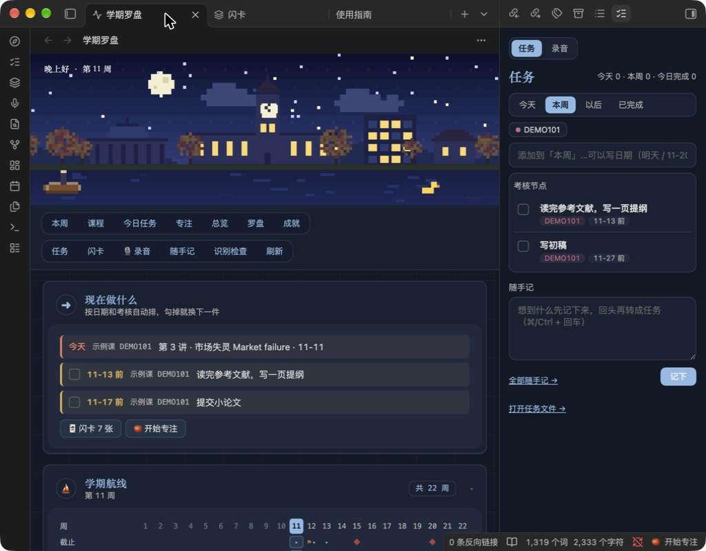
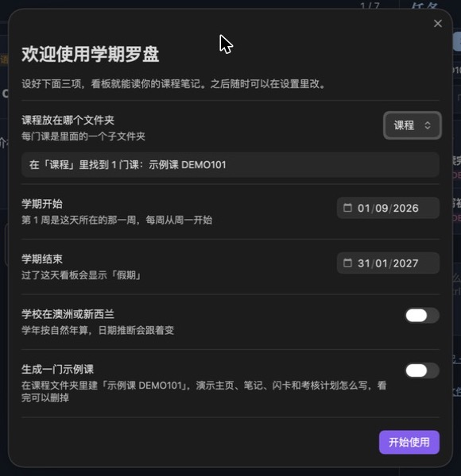
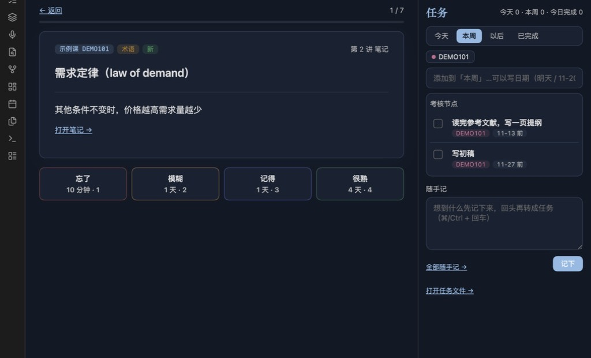

# 学期罗盘 Term Compass

给留学生的 Obsidian 学期看板：打开就知道**现在该做什么**，这学期每门课走到哪了，哪个考核快到了。

所有数据都留在你自己的电脑上，不联网，录音也在本机转写。



## 它能做什么

- **现在做什么**：按日期和考核自动排出最该做的三件事，今天的课、逾期的作业节点、三天内的截止日期，勾掉就换下一件。
- **学期航线**：整学期一周一格，每门课的讲次、截止日、考试、作业节点画在同一条线上，点任意一周看那周的安排。
- **讲次两段**：日期过了或当天录了音算「已上」；这讲链接的笔记或课件 PDF 看满 10 分钟算「读过」，自动完成，不用手动打勾。
- **考核节点**：在作业计划里写 `- [ ] **11-09 → 11-22**：写初稿`，就会出现在看板和本周清单里，过期没勾会提醒。
- **闪卡**：笔记里的「术语表」和「自测题」自动变成闪卡，间隔重复。可以只让闭卷课出新卡，自测题翻面时显示笔记里最相关的一段。
- **任务和随手记**：今天、本周、以后三个清单，带日期的任务到时候自动出现；随手记一键转成任务。
- **录音转写**（电脑版）：上课录音，本机用 whisper 转写，按分钟分段，标记重点；中途退出或崩溃会自动找回。
- **学习罗盘和等级**：课程、英语、专注、收尾四个每日习惯对应罗盘四个方向；专注、听课、阅读、闪卡、手写会积累经验，升级解锁校园小物件、头像装饰和配色。

## 安装

还没上架 Obsidian 社区插件市场，目前有两种装法（需要 Obsidian 1.6.6 或更新）：

1. **BRAT（推荐，能自动更新）**：在社区插件里装好 BRAT，运行命令「BRAT: Add a beta plugin for testing」，填入 `https://github.com/lhp20030603-jpg/term-compass`。
2. **手动**：从 [Releases](https://github.com/lhp20030603-jpg/term-compass/releases) 下载最新版的 `main.js`、`manifest.json`、`styles.css`，放进 vault 里的 `.obsidian/plugins/term-compass/` 文件夹，然后在 设置 → 第三方插件 里打开「Term Compass 学期罗盘」。

第一次打开会弹出设置向导：选课程文件夹、填学期日期，也可以先生成一门示例课看看效果。完成后会在看板旁边打开「学期罗盘/使用指南.md」，讲清楚笔记怎么写看板才能读到（以后运行命令「打开使用指南」可以再生成）。之后随时可以运行命令「识别检查」，看看哪些笔记被认出来、哪些需要改。

<p>
  
  
</p>

## 笔记怎么写

学期罗盘读你本来就在写的笔记，只要遵守几个习惯：

```
课程/                         ← 课程文件夹（向导里选）
  学期总览.md                  ← 「## 关键日期」表格：| 日期 | 事项 | 课程 |
  宏观经济学 ECON201/           ← 每门课一个文件夹
    课程主页.md                ← 每讲一个标题，下面链接这讲的笔记或课件
    第 3 讲 笔记.md            ← 「## 术语表」「## 自测题」会变成闪卡
    作业与考试.md              ← 「## 时间表」下写带日期的考核节点
```

课程主页里每讲一个标题，中英文都行：

```
### 第 3 讲 · 市场失灵 · 10-14
- [[第 3 讲 笔记]]
- [[Week 3 slides.pdf]]

### Lecture 4: Public goods (2026-10-21)
```

- 主页可以叫「课程主页」「Syllabus」「index」或和文件夹同名；都没有的话，讲次标题最多的那篇就是主页。
- 日期写 `10-14`、`2026-10-14` 或 `10月14日`。`10/14` 这种斜杠写法不识别，因为英美两种读法正好相反。
- 手写「完成」或「进行中」在标题末尾，优先于自动判断。

## 录音转写（可选，仅电脑版）

需要先装 whisper.cpp 和一个模型，比如在 Mac 上：

```bash
brew install whisper-cpp
```

再下载一个 ggml 模型（推荐 `large-v3-turbo-q5_0`，约 574 MB），在 设置 → 学期罗盘 → 录音转写 里填好路径，点「检查」。

> 录课之前，请先确认学校和授课老师是否允许录音。课间同学的谈话也可能被录进去，分享转写稿时注意隐私。

## 隐私

- 不联网，不收集任何数据。
- 自动备份默认关闭；打开后只会写到你指定的文件夹。

## 开发

不依赖任何 npm 包，只要 Node 22 以上：

```bash
node build.js        # 从 src/ 生成 main.js 和 styles.css
npm test             # 构建并跑全部测试
./verify.sh          # 提交前：构建、测试、检查密钥和调试输出
```

代码按模块分在 `src/pulse`（看板）、`src/tasks`（任务）、`src/cards`（闪卡）、`src/voice`（录音），每个模块各自一个作用域，`build.js` 把它们拼成 Obsidian 需要的单个 `main.js`。

### 发布新版本

```bash
node scripts/bump.js 0.2.0     # 改 manifest.json、package.json、versions.json
git commit -am "chore: release 0.2.0"
git tag 0.2.0 && git push && git push --tags
```

推送标签后，GitHub Actions 会构建、跑测试，并起草一个带 `main.js`、`manifest.json`、`styles.css` 的 Release。检查后手动点发布。标签必须和版本号一样，不带 `v`。

## 问题和建议

欢迎在 [Issues](https://github.com/lhp20030603-jpg/term-compass/issues) 里提。报告问题时附上「识别检查」的截图最有帮助。

## 许可

MIT
